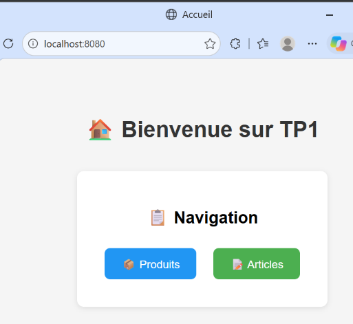
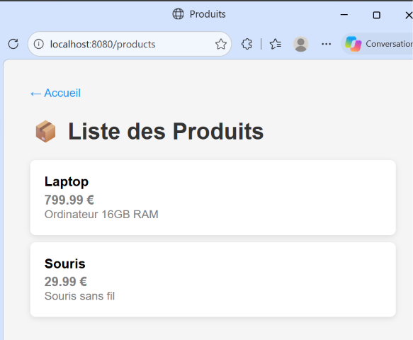
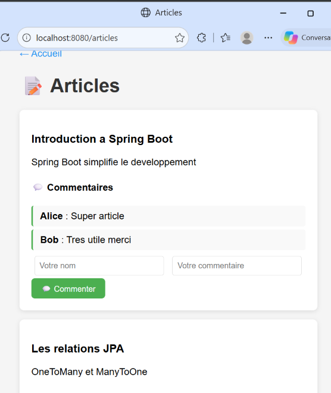
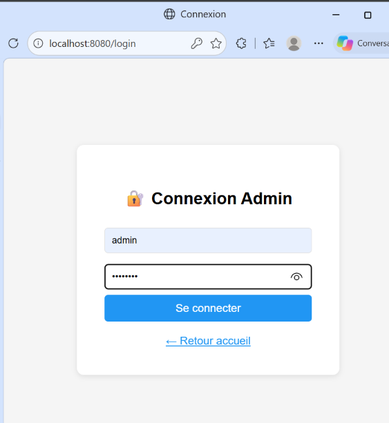
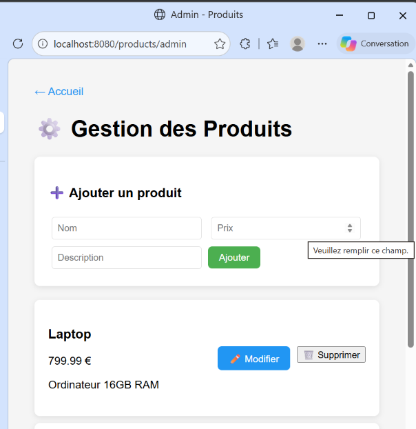
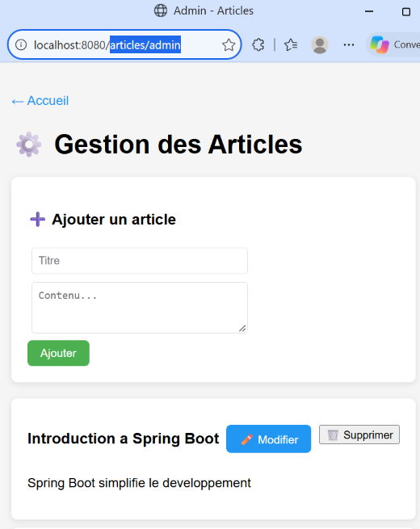
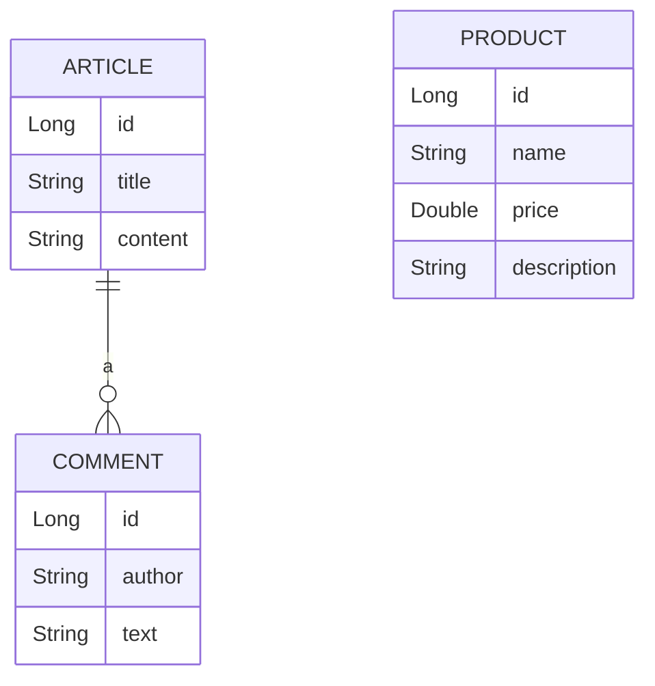

# 🛒 Gestion Produits & Articles — Spring Boot

Application web et API REST pour gérer des **produits**, des **articles** et leurs **commentaires**, avec une interface d'administration sécurisée.

> Projet réalisé dans le cadre d'un TP, puis amélioré (sécurité, configuration par profils, Docker, déploiement).


---

## 📸 Aperçu

| Accueil | Produits | Articles |
|---|---|---|
|  |  |  |

| Connexion admin | Admin produits | Admin articles |
|---|---|---|
|  |  |  |

---

## ✨ Fonctionnalités

- Consultation publique des produits et des articles
- Ajout de commentaires sur les articles (sans connexion)
- Espace **administrateur** protégé par authentification (Spring Security) :
  - création, modification et suppression des produits
  - création, modification et suppression des articles
- **API REST** (JSON) pour les produits, les articles et les commentaires
- Validation des données (nom obligatoire, prix positif, etc.)
- Mots de passe chiffrés avec **BCrypt**
- Protection **CSRF** activée sur l'interface web
- Deux profils : `dev` (base H2 en mémoire + données de démo) et `prod` (MySQL)
- Image **Docker** prête pour le déploiement

---

## 🧰 Technologies

| Domaine | Technologies |
|---|---|
| Langage | Java 21 |
| Framework | Spring Boot 4 (Web MVC) |
| Persistance | Spring Data JPA / Hibernate |
| Sécurité | Spring Security (formulaire de connexion, rôles) |
| Vues | Thymeleaf |
| Validation | Jakarta Bean Validation |
| Bases de données | H2 (dev), MySQL (prod) |
| Outils | Maven, Lombok, Docker |
| Déploiement | Railway |

---

## 🗂️ Modèle de données



---

## 🏗️ Architecture

```
src/main/java/com/example/tp1
├── controller   # ViewController (pages Thymeleaf), ProductController, ArticleController (API REST)
├── service      # logique métier
├── repository   # accès aux données (Spring Data JPA)
├── entity       # Product, Article, Comment
├── security     # SecurityConfig
└── DataInitializer.java   # données de démonstration (profil dev)
src/main/resources
├── templates    # pages Thymeleaf
├── application.properties
├── application-dev.yml
└── application-prod.yml
```

---

## 🚀 Lancer le projet en local

### Prérequis
- Java 21
- (Optionnel) Docker

### Démarrage rapide (profil `dev`)

```bash
git clone https://github.com/VOTRE-PSEUDO/NOM-DU-DEPOT.git
cd NOM-DU-DEPOT
./mvnw spring-boot:run
```

Sous Windows : `mvnw.cmd spring-boot:run`

L'application est disponible sur **http://localhost:8080**

- Base **H2 en mémoire** avec des données de démonstration
- Console H2 : http://localhost:8080/h2-console (JDBC URL : `jdbc:h2:mem:testdb`, utilisateur : `sa`, mot de passe vide)

### 🔐 Compte de démonstration (profil `dev` uniquement)

| Utilisateur | Mot de passe |
|---|---|
| `admin` | `admin123` |

Connexion sur http://localhost:8080/login — ce compte n'existe que pour la démonstration en local.

### Lancer les tests

```bash
./mvnw test
```

---

## ⚙️ Configuration (profil `prod`)

En production, aucun secret n'est écrit dans le code : tout passe par des **variables d'environnement** (voir [`.env.example`](.env.example)).

| Variable | Description |
|---|---|
| `DATABASE_URL` | URL JDBC MySQL |
| `DATABASE_USERNAME` | Utilisateur de la base |
| `DATABASE_PASSWORD` | Mot de passe de la base |
| `ADMIN_USERNAME` | Identifiant de l'administrateur |
| `ADMIN_PASSWORD` | Mot de passe de l'administrateur |
| `SPRING_PROFILES_ACTIVE` | `prod` |

> Spring Boot ne lit pas automatiquement un fichier `.env` : définissez ces variables dans votre système, votre IDE ou votre plateforme de déploiement.

---

## 🐳 Docker

```bash
docker build -t gestion-produits .
docker run -p 8080:8080 \
  -e SPRING_PROFILES_ACTIVE=prod \
  -e DATABASE_URL=jdbc:mysql://host:3306/ma_base \
  -e DATABASE_USERNAME=utilisateur \
  -e DATABASE_PASSWORD=motdepasse \
  -e ADMIN_USERNAME=admin \
  -e ADMIN_PASSWORD=un_mot_de_passe_fort \
  gestion-produits
```

---

## 🔌 API REST

> Les routes `/api/**` nécessitent d'être authentifié.

### Produits — `/api/products`

| Méthode | Route | Description |
|---|---|---|
| GET | `/api/products` | Liste des produits |
| GET | `/api/products/{id}` | Détail d'un produit |
| POST | `/api/products` | Créer un produit |
| PUT | `/api/products/{id}` | Modifier un produit |
| DELETE | `/api/products/{id}` | Supprimer un produit |

### Articles — `/api/articles`

| Méthode | Route | Description |
|---|---|---|
| GET | `/api/articles` | Liste des articles |
| GET | `/api/articles/{id}` | Détail d'un article |
| POST | `/api/articles` | Créer un article |
| PUT | `/api/articles/{id}` | Modifier un article |
| DELETE | `/api/articles/{id}` | Supprimer un article |
| GET | `/api/articles/{id}/comments` | Commentaires d'un article |
| POST | `/api/articles/{id}/comments` | Ajouter un commentaire |

Exemple de corps JSON pour créer un produit :

```json
{
  "name": "Clavier",
  "price": 49.99,
  "description": "Clavier mécanique"
}
```

---

## 🔭 Pistes d'amélioration

- Tests unitaires et d'intégration (services, contrôleurs, sécurité)
- Gestion centralisée des erreurs (`@ControllerAdvice`, exceptions personnalisées)
- DTO pour l'API et pagination des listes
- Documentation OpenAPI / Swagger
- `docker-compose` avec MySQL
- Intégration continue (GitHub Actions)

---


